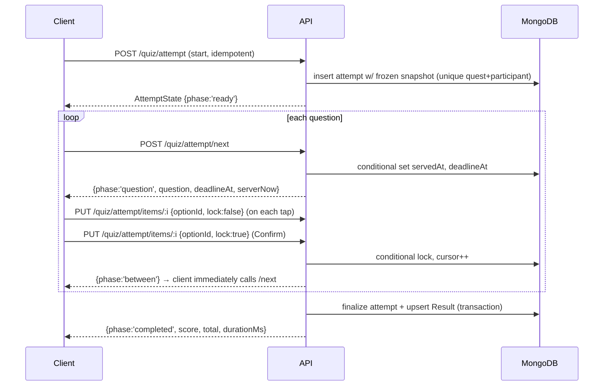
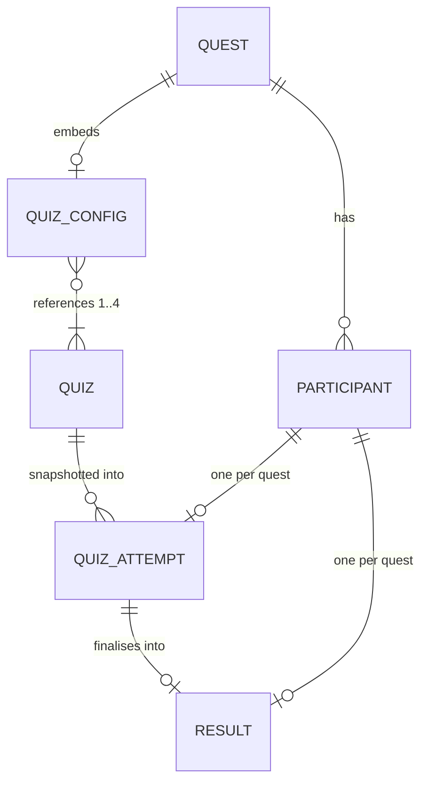
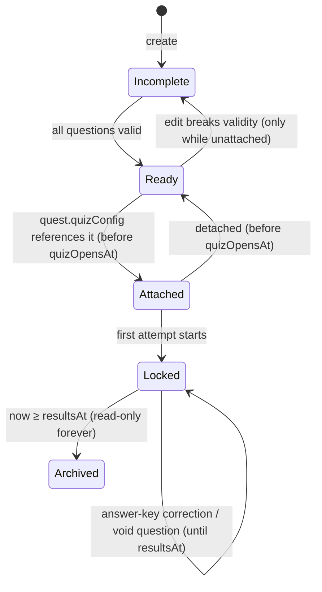
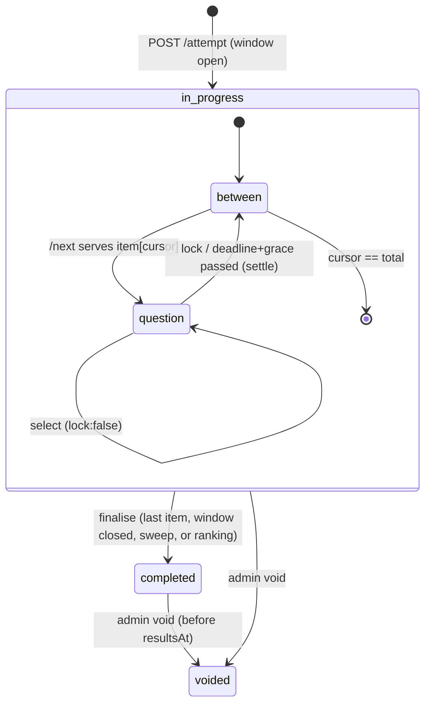

# Quiz — Architecture Audit & Design

**Goal:** registered participants take the quest's quiz in the app. Every attempt is preserved, scored
on the server, and ranked fairly by *correct answers, then total time*. Admins author quizzes, attach
them to a quest, split participants across variants, watch the quiz live, and fix a wrong answer key
before results go out.

**Why now:** this is the last missing piece of the yearly loop. Results, ranking, certificates and
delivery are already built and waiting on a `Result` row that "the quiz (not yet built)" is supposed
to write (`apps/api/src/models/result.model.ts`). The quest still carries placeholder quiz fields
(`quizQuestionCount`, `quizDurationMinutes`) that only feed one line of copy on Home.

**What the quiz has to do:** write exactly one correct, auditable `Result` per participant who
starts. Everything after that (ranking, podium, certificates, verification) already exists and keeps
working.

**Anti-goals (a failure even if it technically works):**
- A participant loses an attempt or an answer because of a refresh, a dropped connection, a second
  tab or a server restart.
- Two participants with the same performance get different ranks for a reason they can't see, like
  network luck or device clock.
- A correct answer, or a question the participant hasn't reached, can be read from the network tab.
- An honest participant gets penalised by a cheat detector.
- Admin edits made while people are taking the quiz change anyone's questions.

**Legend used throughout:** **[Confirmed]** = exists in the code today · **[Proposed]** = this spec ·
**[Assumption]** = believed true, verify · **[Decision: user]** = decided by the product owner in the
brainstorm · **[Call]** = the designer's call, open to review.

---

## Part A — Architecture readiness audit

### A1. What exists (confirmed)

| Area | State today |
|---|---|
| Monorepo | pnpm + turbo. `apps/api` (Express 5, Mongoose 9, zod 4, pino), `apps/web` (Vite, React 19, React Router 8, React Query 5, Zustand 5, Tailwind 4, react-hook-form), `apps/bot` (Telegraf), `packages/shared` (zod schemas + rules shared by both sides). |
| Backend layering | `routes → controllers → services → models`, one response envelope `{ok,data}` / `{ok:false,error}`, `ApiError` as the only thrown type, Express 5 forwards async errors (`middlewares/error.middleware.ts`). Clean and consistent. |
| Auth | Bearer JWT carrying only `sub` (`utils/token.ts`, 7-day expiry). The user is re-read on every request; admin is checked per request against env allowlists (`requireAdmin` mounted once on `/admin`). The web client re-authenticates once on 401 through the Telegram bridge (`lib/api/client.ts`). |
| Quest lifecycle | One current quest (partial unique index on `isCurrent`). Phase is **derived** from five dates, never stored (`resolvePhase` in `services/quest.services.ts`): `upcoming → reading → quiz → finished`. Date order enforced by the shared `findQuestDateIssues`. |
| Participants | One registration per user per quest (unique `{quest,user}`). The official **participant number** (3000–3999) comes from an atomic counter per quest (`models/counter.model.ts`), is permanent, and gaps are possible (a number is burned if the insert fails). Registration closes at `readingDeadline`. **No participant deletion exists.** |
| Results & ranking | `Result {quest, participant, score, total, durationMs, submittedAt, rank, certificateCode…}`, unique `{quest,participant}`, index `{quest, score:-1, durationMs:1}`. Ranked lazily on the first read after `resultsAt`, with a total order (score↓, durationMs↑, submittedAt↑, _id↑), so concurrent rankers agree. Frozen once ranked. In-process leaderboard cache (`services/result.services.ts`). |
| Certificates | Built and shipped on top of `Result` (tiers 1–3, PNG render, bot delivery, `/verify`). |
| Transactions | `withTransaction` uses a real transaction on a replica set and runs unwrapped on a standalone dev `mongod` (`utils/transaction.ts`). |
| Rate limiting | In-memory `express-rate-limit`, keyed per user where signed in (so a school NAT doesn't share one bucket). Global 300/min per user. |
| Deployment | API on Railway, **one instance** (README; in-memory limiter and caches assume it). Web on Vercel. Bot single replica. |
| Background work | No job queue. Boot-time recovery (`markInterruptedBroadcasts`, `markInterruptedCertificateDeliveries`) and a `setInterval` cover sweep in `server.ts`. |
| Frontend | Feature-first folders, React Query for server state, mock API layer (`lib/api/mock/`) that mirrors the contract. `/quiz` is a public countdown placeholder (`features/quiz/QuizPage.tsx`). The tab bar's centre slot is already **Quiz** until the quiz closes, then **Results** (`components/layout/TabBar.tsx`). Admin quest editor has a **Quiz** tab holding the two placeholder fields (`QuizMetaFieldsSection.tsx`). |
| Tests | None, and the owner's preference is no test suite. Verification is scripted drills plus manual acceptance (§17). |

### A2. Readiness questions

1. **Is the architecture ready?** Mostly. The layering, auth, derived-phase model, atomic counters and
   race-free ranking are sound and should be reused as-is. Nothing needs rewriting.
2. **What can be built safely on it as-is?** Quiz authoring, attempts, scoring, writing `Result`, and
   every downstream screen. 100 concurrent participants is a light load for this stack (§15).
3. **What should change first?** Four small server-side fixes (A3, items C1–C4). Each is a few lines
   plus a validation rule.
4. **Database changes?** Two new collections (`quizzes`, `quizattempts`), one new subdocument on
   `Quest` (`quizConfig` + a derived `quizSummary`), and two placeholder fields removed. `Result` is
   unchanged.
5. **Problems at 100+ simultaneous?** Not CPU or Node: the realistic risks are the MongoDB Atlas tier
   (shared tiers cap operations per second), a deploy during the quiz window, and the in-memory rate
   limiter if someone scales the API to two instances.
6. **What could make an attempt fail, corrupt or vanish?** With today's code nothing exists to fail.
   With a naive design: client-held timers, answers kept only in browser memory, a "submit at the end"
   payload, last-write-wins updates, or ranking before abandoned attempts are finalised. Every one is
   designed out (§13, §14).
7. **What could let participants manipulate results?** With a naive design: correct answers in the
   payload, client-reported scores or durations, replaying an answer request, refreshing to reset a
   timer, or fetching future questions. All are closed by server-only keys, server timestamps,
   conditional atomic writes and one-question-at-a-time delivery (§12).

### A3. Findings

| # | Area | Current state | Risk for the quiz | Recommendation | Priority |
|---|---|---|---|---|---|
| C1 | Results timing | `resultsAt` may equal `quizClosesAt` (`findQuestDateIssues`). Ranking fires on the first read after `resultsAt`. | An answer arriving in its grace window, or an abandoned attempt not yet finalised, would miss the ranking or force a re-rank after ranks are frozen. | Require `resultsAt ≥ quizClosesAt + 5 min` in the shared rule, **and** make `rankQuest` finalise every open attempt before it ranks (§13.5). | **Critical** |
| C2 | Date locking | Past dates lock only in the admin UI (`DateTimelineField`). `updateQuest` accepts any date edit. | Moving `quizOpensAt` or pulling `quizClosesAt` earlier while people are mid-quiz silently cuts their attempt short. | Server rule: once `now ≥ quizOpensAt`, `quizOpensAt` is immutable and `quizClosesAt` can only move later (§13.6). | **Critical** |
| C3 | Placeholder quiz fields | `quizQuestionCount` / `quizDurationMinutes` on `Quest`, hand-typed. | Two sources of truth for question count and duration that will drift from the real quiz. | Replace with a derived `quest.quizSummary` written by the server whenever quiz config or an attached quiz changes; migrate and `$unset` (§7, §18). | High |
| C4 | Web API client | `fetch` with no timeout, no `PUT`/`DELETE` helpers, no retry. | A hung request on a bad mobile connection freezes the quiz screen with no feedback. | Add `put`/`delete`, an optional `signal`/timeout, and a small retry helper used only by the idempotent quiz calls (§14). | High |
| C5 | Body size | `express.json({limit:'100kb'})` globally. | A 100-question quiz saved as one document can exceed 100 kB. | Route-specific `512kb` parser on `PUT /admin/quizzes/:id`, mounted before the global one (same pattern as `/bot/interactions` in `app.ts`). | High |
| C6 | Single instance | In-memory rate limits, leaderboard cache, ranking-in-flight map. | Correct today. Scaling to two API instances would split rate-limit buckets and duplicate caches, but quiz correctness would not break, because every quiz guarantee lives in MongoDB. | Keep one instance. Document "no horizontal scaling without a shared limiter". No Redis now. | Medium |
| C7 | Database tier | **[Assumption]** MongoDB is Atlas (transactions are used in prod). Tier unknown. | Atlas M0/Flex shared tiers throttle operations per second. A 100-person start burst (~2 ops per call) is close to the M0 ceiling. | Confirm the tier. If M0, move to a dedicated tier for quiz day, or at least run the drill (§17) against it. | Medium, **needs owner action** |
| C8 | Deploys | Railway restarts the API on deploy. | In-flight requests drop. State survives (it's in MongoDB), but participants see a blip. | Operational rule: no API deploys during the quiz window. The client already retries idempotent calls (§14). | Medium |
| C9 | Participant removal | Not implemented. | None today. If added later, a removed participant's attempt/result must be handled. | Out of scope. Note for the future: removal after quiz open should void the attempt, not delete it. | Low |
| C10 | Ties | Ranks are unique (no shared places); tie order ends on `submittedAt`, then `_id`. | With millisecond durations, exact ties are near-impossible; the fallback is deterministic. | Keep. Documented in §11. | Low |

### A4. Verdict

**Ready after specific improvements.** The foundation is good, and the quiz fits the existing patterns
without new infrastructure. C1 and C2 must land before (or as the first step of) quiz development,
because they protect results integrity. C3–C5 land during implementation. C7 is a check only the
owner can do.

---

## Part B — Quiz design

## 1. Feature overview & goals

- A **Quiz** is a reusable, authorable entity (title, description, questions, settings) that lives in
  an admin library.
- A **Quest** attaches one or more quizzes through a **distribution**: one quiz for everyone; two quizzes
  split by odd/even participant number; or 2–4 quizzes split at random. **[Decision: user]** Variant
  quizzes share **one leaderboard**.
- The quiz runs inside the quest's existing window, `quizOpensAt → quizClosesAt`, which may last hours
  or a day. **[Decision: user]**
- Each participant gets **one attempt**. Questions are served **one at a time**, each with its own
  **server-enforced time limit**, and answers are **locked once confirmed** (no going back).
- **Score** = correct answers. **Time** = sum of per-question elapsed time, measured on the server.
  Rank = score ↓, then time ↑.
- Results keep the existing pipeline: frozen ranks at `resultsAt`, podium of 3, certificates.
  The results page **visually highlights the top 5**; prizes and medal certificates stay at 3.
  **[Decision: user]**

### Goals, in priority order (from the brief)
1. Accuracy & fairness · 2. Reliability · 3. Performance (≥100 concurrent) · 4. Anti-cheat · 5. UX.

### Non-goals (v1)
- Question types beyond True/False and single-answer MCQ. Multiple correct answers was considered and
  rejected for v1: scoring partial credit complicates "correct answer count" and nobody asked for it.
- Weighted scoring by difficulty. Difficulty is authoring metadata and is used to keep variants
  balanced; it doesn't change points.
- Question pools (draw N of M per participant). Rejected: it gives participants different questions on
  one leaderboard, which is the fairness problem variants already strain.
- Proctoring (webcam, screen lock, full-screen enforcement). Unreliable in a Telegram webview and
  invasive.
- Retakes, practice mode, multiple quizzes per participant per quest.
- Real-time push (WebSockets/SSE). Not needed at this load (§15).

---

## 2. Functional requirements

**Participant**
- P1. See their quiz status on `/quiz` in every state listed in §4.1.
- P2. Start the quiz once, between `quizOpensAt` and `quizClosesAt`, if registered for the current quest.
- P3. Answer one question at a time: see the prompt, the options, a countdown and their progress.
- P4. Selecting an option saves it to the server right away; **Confirm** locks it. When time runs out,
  the last saved selection counts. With no selection, the question counts as unanswered.
- P5. Resume after refresh, closed tab, lost connection or a switch of device, at the exact server state.
  The clock for a served question keeps running.
- P6. See a completion screen with the provisional score (correct of total) and time.
- P7. After `quizClosesAt`: review their own answers next to the correct answers (§8.1, Phase 5).
- P8. After `resultsAt`: see their rank through the existing Results screen.

**Admin**
- A1. List, create, edit, duplicate and delete quizzes in a library (`/admin/quizzes`).
- A2. Edit the title, description, settings (shuffle questions, shuffle MCQ options, default time limit)
  and questions (add, edit, remove, reorder, type, prompt, options, correct answer, time limit,
  difficulty, optional explanation).
- A3. Preview a quiz exactly as a participant sees it, with an optional "show answers" toggle.
- A4. In the quest editor's **Quiz** tab: choose a distribution, pick the quiz for each group, and see
  readiness checks and group sizes.
- A5. Content and quest quiz config lock as soon as the first participant starts (§13.6). Only answer-key correction and voiding
  a question remain allowed, until `resultsAt`.
- A6. During the window: a live monitor of started, in-progress and completed counts per variant, plus
  an attempts list with detail and flags.
- A7. Void an individual attempt with a reason, before `resultsAt`.

---

## 3. Non-functional requirements

| | Requirement |
|---|---|
| Integrity | Server is the sole authority for questions served, time, answers, score and completion. No client-sent score, time, order or status is ever trusted. |
| Durability | Every select, lock and serve is persisted before the API responds. A participant never holds state that exists only on their device. |
| Idempotency | Every participant write is safe to retry and safe to receive twice (§13). |
| Determinism | Given the stored attempt, re-scoring yields the same score and duration. Ranking is a total order. |
| Auditability | The attempt stores a frozen snapshot of the exact questions and option order shown, plus all server timestamps (§7.3). |
| Latency | p95 < 300 ms for quiz endpoints at 150 concurrent participants on the production DB tier. |
| Capacity | ≥150 concurrent attempts with margin; the participant cap is 1000 (3000–3999). |
| Availability | An API restart mid-quiz loses no data. Clients resume through retries. |
| Responsiveness | Quiz screen usable from 320 px wide; touch targets ≥ 44 px; works in Telegram webview and mobile/desktop browsers. |
| Accessibility | Options are real buttons with `aria-pressed`; the timer has an `aria-live="polite"` announcement at 10 s and 0 s only (not every second); full keyboard support (1–6 select, Enter confirms). |

---

## 4. Participant user flows

### 4.1 `/quiz` overview states

The overview is driven by `GET /quiz/me` for signed-in users, and by `GET /quests/current` alone for
signed-out visitors (they see the countdown plus a sign-in prompt, as today).

| State (`QuizOverview.state`) | When | What the screen shows |
|---|---|---|
| `no_quest` | No current quest | "No quiz scheduled", as today's empty state. |
| `not_registered` | Quest exists, user not registered | Quiz date plus "Register to take part" (to `/me`), or "Registration closed" after `readingDeadline`. |
| `not_configured` | Registered, but the quest has no complete quiz config | Countdown to `quizOpensAt` with "Questions are being prepared". Never blocks; the admin readiness checks (§5.4) catch this. |
| `upcoming` | Registered, configured, `now < quizOpensAt` | Countdown to unlock, quiz title/description, question count and total time budget, rules card. |
| `open` | `quizOpensAt ≤ now < quizClosesAt`, no attempt | **Hero CTA "Start quiz"**, rules card, closes-in countdown. If `now > quizClosesAt − totalTime` (an amber warning): "The quiz closes in 12 min — you may not have time for every question." |
| `in_progress` | Attempt `in_progress`, window open | "Continue quiz", progress "Question 7 of 20". |
| `completed` | Attempt completed, `now < resultsAt` | Provisional score and time, "Results on {resultsAt}". After `quizClosesAt`: "Review answers". |
| `missed` | No attempt, `now ≥ quizClosesAt` | "The quiz has closed." Neutral tone, no blame. |
| `voided` | Admin voided the attempt | "Your attempt was withdrawn by the organisers," plus the reason if one was given. |
| `results` | `now ≥ resultsAt` | `/quiz` redirects to `/results`. |

**Tab bar and redirect change [Call].** **[Confirmed]** Today `phase` becomes `finished` at
`quizClosesAt` (`resolvePhase`), and both the tab bar's centre slot (`TabBar.tsx`) and `QuizPage`'s
redirect key off `phase === 'finished'`. That would hide the `completed`, `missed` and `voided`
states and the review between close and results. **[Proposed]** Leave `QuestPhase` unchanged and move
both checks to `now ≥ resultsAt` (a shared helper `isResultsOut(quest, now)`). The centre slot reads
**Quiz** until results are published, then **Results**. No navbar position change is needed: Quiz
already sits in the centre of five.

### 4.2 Taking the quiz



1. **Start.** Tap "Start quiz" opens a one-screen rules sheet (questions, per-question timer, no going
   back, timer keeps running if you leave). "I'm ready" calls `POST /quiz/attempt` and goes to
   `/quiz/play`. **[Call]** One confirm step: it's the only friction, and it prevents an accidental
   start.
2. **Question.** The client calls `POST /quiz/attempt/next`. The server serves the next question and
   starts its clock. The client shows the prompt, options, a timer ring (from `deadlineAt` corrected by
   server offset, §12.4) and a progress rail.
3. **Select.** A tap highlights the option and fires `PUT …/items/:i {lock:false}` in the background.
   The participant can change selection freely until they confirm. A small "saved" tick shows after
   the server acknowledges.
4. **Confirm.** "Confirm" (or Enter) sends `{lock:true}`. The UI shows "Locked in" for about 400 ms
   (haptic `success` in Telegram), then automatically calls `/next`. No correct/incorrect feedback.
5. **Time runs out.** At 0 the client shows "Time's up" and calls `/next`. The server settles the
   expired question (counts the last saved selection, or unanswered) and serves the next.
6. **Last question.** `/next` with nothing left finalises the attempt and returns `completed`. The
   client shows the completion screen.
7. **Interruptions.** On reopen, `/quiz` shows `in_progress`, and "Continue" goes to `/quiz/play`. That
   calls `GET /quiz/attempt`, which returns the current served question with its original deadline, or
   `between` ("Ready for question 8?" with a **Continue** button, so a returning participant isn't
   ambushed by a running clock).

**Why no going back [Call]:** per-question timers make "go back" incoherent (whose clock runs?).
Locked answers also make the time measure honest and the anti-cheat simpler. Alternative considered:
a quiz-wide timer with free navigation. Rejected because the brief asks for per-question timers and
auto-progression.

**Why the next question is served on request, not bundled into the answer response:** the clock for
question N+1 starts only when the client asks for it. If the connection drops right after a confirm,
the participant loses no time. Pausing *between* questions reveals nothing, because the next question
hasn't been sent yet.

---

## 5. Admin user flows

### 5.1 Library — `/admin/quizzes`
- A new admin tab, **Quizzes** (icon `ListChecks`). The admin tab bar goes from 6 to 7. **[Call]**
  Check it fits at 360 px; if not, shorten labels ("Broadcast" → "Send").
- A list of cards: title, question count, total time, difficulty mix (e.g. `6·8·6`), status chips
  (**Incomplete** / **Ready** / **Attached to Edition 4 · Odd** / **Locked**), and updated-at.
- Actions: **New quiz** (title required, then the editor opens), **Duplicate**, **Delete** (only if
  unattached and without attempts; behind a confirm sheet).

### 5.2 Editor — `/admin/quizzes/:id`
Layout follows the quest editor: an `AdminScreen`, a header, `SaveBar` with a change count,
`useUnsavedChangesGuard`, ⌘S via `useSaveShortcut`, and react-hook-form + zod (shared schema).

- **Details:** title (required, ≤120), description (optional, ≤2000).
- **Settings:** shuffle questions (default on), shuffle MCQ options (default on), default time limit
  (default 30 s, 5–300).
- **Questions:** a vertical list of collapsible question cards.
  - Collapsed: number, type badge, first line of prompt, difficulty dot, time, error badge.
  - Expanded: type segmented control (True/False | Multiple choice), prompt textarea, options editor,
    a radio for the correct option, time limit (blank = default), difficulty (Easy/Medium/Hard,
    default Medium), optional explanation (shown in post-close review).
  - MCQ options: 2–6, add/remove, reorder. T/F options are fixed (`true` / `false`); only the correct
    one is chosen.
  - Reorder: drag handle plus **move up / move down** buttons (keyboard and touch safe). **[Call]**
    Add `@dnd-kit/core` + `@dnd-kit/sortable`, since there's no DnD library today and native HTML5 DnD
    is broken on touch. With shuffle on, order only matters for the preview and review screens; the
    editor says so.
  - Add question: a sticky "+ Question" button at the end. New questions copy the previous question's
    type and difficulty.
- **Summary bar** (always visible): `20 questions · 10 min total · Easy 6 · Medium 8 · Hard 6`, plus
  validation status.
- **Preview** button: opens `/admin/quizzes/:id/preview`, which renders the participant `QuestionCard`
  flow from the unsaved form state, with a local fake clock and a "Show answers" toggle. No attempt is
  written.
- **Locked state:** once any participant has started this quiz, all inputs are read-only and a
  banner explains why. Each question gets a **Correct answer key** action (§5.5).
- **Saving:** full-document `PUT` with `revision` (optimistic concurrency). A 409 `stale` shows
  "Someone else saved this quiz. Reload to see their version" and keeps the local edits visible.
  Drafts may be incomplete (missing correct answer, empty prompt): saving is allowed, and the quiz
  shows **Incomplete** with per-question error badges.

### 5.3 Quest editor → Quiz tab (replaces `QuizMetaFieldsSection`)
- **Distribution:** `One quiz for everyone` | `Odd / even numbers` | `Random groups (2–4)`.
- Per group, a quiz picker (only **Ready** quizzes not attached to another quest). Group labels:
  "Everyone" / "Odd numbers" / "Even numbers" / "Group 1…N".
- **Live group sizes** from the current roster: "Odd: 52 · Even: 48".
- **Readiness checklist** (each ✓ / ✗ with a fix link):
  1. Every group has a ready quiz.
  2. Variants match in shape: same question count, same count per difficulty, same total time
     (**blocking**, §5.6).
  3. `resultsAt ≥ quizClosesAt + 5 min`.
  4. The quiz window is at least as long as the quiz's total time.
- Saved through the existing quest `PATCH` and `SaveBar`, so the quiz tab dirties and saves like the
  other tabs. Changing distribution or quizzes goes through `ReviewChangesSheet` (it is risky).
- Locked (read-only) once the quest has any attempt (§13.6).

### 5.4 Live monitor — `/admin/quizzes/live` (visible while phase is `quiz`, and until `resultsAt`)
- Per-variant tiles: assigned · started · in progress · completed, plus average score and time once
  any are completed. These double as an early warning if one variant is clearly harder.
- An attempts table (reuse `ParticipantsTable` patterns): number, name, variant, status, progress `7/20`,
  score, time, flags. Filter by status and flag, search by number or name. A row opens a detail sheet
  with the per-question timeline (served, selected, locked, outcome, elapsed, signals). Admins see
  correct answers here.
- **Void attempt** (with a reason, confirm sheet), allowed before `resultsAt`. This deletes the
  attempt's `Result` and keeps the attempt as `voided` for audit.
- Polls `GET /admin/quiz/live` every 15 s while the page is visible (`refetchInterval` +
  `refetchIntervalInBackground:false`). No other admin page polls.

### 5.5 Answer-key correction (locked quizzes, until `resultsAt`)
- Per question: **Change correct answer** (pick another option) or **Void question** (removed from
  score and total for everyone on that quiz). Each needs a typed confirmation and an optional note.
- The server re-scores every non-voided attempt on that quiz from their stored answers and updates
  their `Result`. This is idempotent: re-scoring reads the snapshot, never the live quiz.
- Every correction is appended to `quiz.corrections[]` (who, when, what, note) and shown in the editor.
- **Variants:** voiding a question on one variant makes totals differ between variants (19 vs 20). The
  sheet warns, and suggests voiding a matching-difficulty question on the other variant or accepting
  the mismatch. **[Call]** Allowed, with the warning, rather than blocked: a broken question must be
  voidable.

### 5.6 Why variants must match in shape
**[Decision: user]** Variants share one leaderboard. Fairness then depends on the variants being
equally hard, which no system can guarantee, but it can rule out the obvious imbalances. **[Call]**
Attaching variants is **blocked** unless they have the same question count, the same count per
difficulty tag, and the same total time budget (sum of time limits). After the quiz, the live
monitor's per-variant averages let the organisers spot a lopsided pair. Alternatives considered:
separate leaderboards per variant (rejected by the owner), and score normalisation (z-scores per
variant). That was rejected because it's unexplainable to participants ("I got 18 but rank below
someone with 17").

---

## 6. UI/UX requirements

**Visual language:** existing tokens in `styles/theme.css` (ember/amber accents on the dark stage),
sans display type with width-axis personality (no serif display face), Archivo, existing `Button`,
`Sheet`, `Countdown`, `EmptyState`, `ErrorState`, `LoadingState`. Admin follows `AdminScreen` +
compact fields.

**Quiz screen (`/quiz/play`)**
- Full-height layout, **tab bar hidden** (the route sets a flag in `ui.store`) so nothing invites a
  stray navigation. The Telegram BackButton is hidden while a question is live. Closing confirmation is
  already enabled globally (`lib/telegram.ts` `initTelegram`).
- Top: progress rail (20 ticks: answered / current / ahead; no right/wrong colouring) and "7 / 20".
- Timer: a circular ring plus seconds; amber under 10 s, ember under 5 s; a soft haptic tick at 5 s in
  Telegram. Rendered from `deadlineAt − (Date.now() + serverOffset)`, recomputed per animation frame,
  so it never drifts.
- Prompt: large, readable (`text-xl` up to `text-2xl` on desktop), wraps; `user-select: none` as a
  deterrent only.
- Options: full-width buttons, letter badges A–F, selected state with check, ≥ 56 px tall. T/F renders
  as two big side-by-side buttons.
- Confirm: a sticky bottom button, disabled until something is selected, with label "Confirm".
- Save status: a tiny inline indicator ("Saved" ✓ / "Saving…" / "Offline — retrying"). Never a modal
  during a question.
- **Connection banner:** after 2 s of failed requests, "Connection lost. Your saved answer is safe;
  we'll keep trying." The timer keeps running (truthfully).
- **Between screen** (only on resume or after a time-out): "Question 8 of 20 is ready" plus Continue.
- **Completion:** "Done!", score `17 / 20` (labelled provisional until results), time `4:12.3`, "Results
  are published on 12 Dec, 18:00", and a link back to Stage. Light confetti from existing motion
  tokens; respect `prefers-reduced-motion`.
- **Another tab:** a `BroadcastChannel('bq-quiz')` ping. If another tab of this browser has the quiz
  open, show "The quiz is open in another tab — continue here?" (taking over just refetches state).
  This is UX only; the server is authoritative regardless.

**States to design:** loading (skeleton question), error (retry), offline, time's up, locked-in,
between, completed, voided, closed-mid-attempt ("The quiz closed. Unanswered questions were counted
as unanswered.").

**Overview (`/quiz`)**: one primary card per state (§4.1). The `open` state uses the hero treatment
(large CTA in ember, gentle pulse, "Quiz is open" label, closes-in countdown) so readiness is
unmistakable.

---

## 7. Database schema & relationships



### 7.1 `Quest` (modified) — `models/quest.model.ts`

```ts
// Removed: quizQuestionCount, quizDurationMinutes
quizConfig: {
  distribution: { type: String, enum: ['single', 'parity', 'random'], required: true },
  // single: [all]; parity: [odd, even]; random: [g1..gN], 2 ≤ N ≤ 4. Position = group.
  quizzes: { type: [{ type: ObjectId, ref: 'Quiz' }], required: true },
  // random only: 32 random bytes hex, generated by the server on first save of 'random'; never sent to clients.
  seed: { type: String, default: null }
} | null   // default null

// Derived by the server whenever quizConfig or an attached quiz changes. Read by Home/overview.
quizSummary: { questionCount: Number, totalSeconds: Number } | null   // default null
```
- **Why on Quest, not on Quiz:** the distribution must split *all* participants into exactly one quiz
  each. Storing it per quiz ("this quiz is for odd numbers") lets two quizzes both claim odd, or nobody
  claim even. One config on the quest makes a full partition the only thing you can express.
- **Why the window stays on Quest:** phase derivation, Home countdowns, registration close, results
  gating and the tab bar already read the quest's dates. A second schedule on the quiz would duplicate
  them. A quiz is content; the quest is the event.
- Index: `{ 'quizConfig.quizzes': 1 }`, for "is this quiz attached anywhere?".

### 7.2 `Quiz` (new) — `models/quiz.model.ts`

```ts
const optionSchema = { id: String /* nanoid(8) or 'true'|'false' */, text: String /* 1–200 */ }, { _id:false }

const questionSchema = {
  id: { type: String, required: true },          // nanoid(10), client-generated, stable for life
  type: { type: String, enum: ['true_false', 'mcq'], required: true },
  prompt: { type: String, default: '' },          // ≤500; may be empty in a draft
  options: [optionSchema],                        // tf: exactly [{id:'true'},{id:'false'}]; mcq: 2–6
  correctOptionId: { type: String, default: null },
  timeLimitSec: { type: Number, default: null },  // null = settings.defaultTimeLimitSec; 5–300
  difficulty: { type: String, enum: ['easy', 'medium', 'hard'], default: 'medium' },
  explanation: { type: String, default: null }    // ≤500, shown only in post-close review
}, { _id:false }

quizSchema = {
  title: { type: String, required: true, trim: true },  // 1–120
  description: { type: String, default: null },         // ≤2000
  settings: {
    shuffleQuestions: { type: Boolean, default: true },
    shuffleOptions: { type: Boolean, default: true },   // MCQ only; T/F always True, False
    defaultTimeLimitSec: { type: Number, default: 30 }
  },
  questions: { type: [questionSchema], default: [] },   // ≤100
  revision: { type: Number, default: 0 },               // optimistic concurrency, +1 per save
  corrections: [{ questionId, kind: 'key'|'void', from: String|null, to: String|null,
                  note: String|null, by: ObjectId /* User */, at: Date }],
  voidedQuestionIds: { type: [String], default: [] }
} + timestamps
```
- **Embedded questions, not a `questions` collection:** a quiz is read and written as a whole (editor
  save, snapshot at start); ≤100 questions × ~1 kB is far below 16 MB; no cross-quiz question queries
  are needed. Alternative (separate collection) adds joins and multi-doc consistency for no benefit.
- **Completeness** is computed, not stored: `isComplete = questions.length ≥ 1 && every question valid
  (prompt non-empty, options valid for type, correctOptionId ∈ options)`. Shared function
  `findQuizIssues(quiz)` in `packages/shared` (same pattern as `findQuestDateIssues`).
- **Lock** is derived: a quiz is locked when any attempt references it (§13.6).
- **Attachment** is derived: a quiz is *attached* when the current quest's `quizConfig` references it.
  A quiz referenced only by an archived quest shows **Used in Edition N**: read-only, never offered in
  the picker. Reuse is through **Duplicate** only. **[Call]** Archived quests keep their config for
  audit. No "published" flag: attaching it to a quest *is* scheduling it, and
  detaching it (allowed until the window opens) *is* unpublishing.
- **Versioning:** no version table. Content becomes immutable at lock, and every attempt carries its
  own snapshot (§7.3), so later answer-key corrections are explicit, logged and applied by re-scoring.
  `revision` exists only to stop two admins overwriting each other.

### 7.3 `QuizAttempt` (new) — `models/quiz-attempt.model.ts`

```ts
const itemSchema = {
  questionId: String,
  type: String, prompt: String, explanation: String|null,
  options: [optionSchema],          // in the order THIS participant sees them
  correctOptionId: String,          // copied at start; changed only by an answer-key correction
  voided: { type: Boolean, default: false },
  difficulty: String,
  timeLimitMs: Number,
  servedAt: Date|null, deadlineAt: Date|null,
  selectedOptionId: String|null, selectedAt: Date|null,
  lockedAt: Date|null,
  outcome: { enum: ['locked', 'auto', 'timeout', 'unserved', null] },  // null = unresolved
  isCorrect: Boolean|null,
  elapsedMs: Number|null,
  signals: { hiddenCount: Number, hiddenMs: Number }   // client-reported, advisory only
}, { _id:false }

quizAttemptSchema = {
  quest: ObjectId, participant: ObjectId, user: ObjectId, quiz: ObjectId,
  quizRevision: Number,
  group: { type: Number },          // index into quest.quizConfig.quizzes; frozen at start
  status: { enum: ['in_progress', 'completed', 'voided'], default: 'in_progress' },
  cursor: { type: Number, default: 0 },   // index of the first unresolved item; == items.length when done
  items: [itemSchema],
  startedAt: Date,
  completedAt: Date|null,
  finalizedBy: { enum: ['participant', 'sweep', 'ranking', null] },
  score: Number|null, total: Number|null, durationMs: Number|null,
  resultWrittenAt: Date|null,       // repair marker, §13.4
  clientIds: { type: [String], default: [] },   // ≤10 distinct per-tab ids seen
  flags: { type: [String], default: [] },       // computed at finalise, §12.6
  voidReason: String|null, voidedBy: ObjectId|null, voidedAt: Date|null
} + timestamps

index({ quest: 1, participant: 1 }, { unique: true })   // one attempt per person per quest — the guarantee
index({ quest: 1, status: 1 })                          // sweep, live counts
index({ quiz: 1, status: 1 })                           // re-score on correction
```
- **Why a full snapshot per attempt:** the attempt alone proves what was shown, in what order, when,
  what was chosen and how it was scored, even if the quiz is later corrected. It's 20–100 items at
  under 1 kB each.
- **`Result` is unchanged**, and is written from the attempt at finalisation (§13.4). It stays the
  ranking input, so the leaderboard, certificates and stats code doesn't change.

### 7.4 Group resolution (deterministic, stable)

```ts
function resolveGroup(config, participant): number {
  switch (config.distribution) {
    case 'single': return 0;
    case 'parity': return participant.number % 2 === 1 ? 0 : 1;          // [odd, even]
    case 'random': {
      const h = hmacSha256(config.seed, String(participant._id));
      return h.readUInt32BE(0) % config.quizzes.length;
    }
  }
}
```
- Uses the **official participant number** for parity, never `_id` or registration order. **[Confirmed]**
  `number` is the person's permanent 4-digit number (`participant.model.ts`).
- Random uses each participant's own hash, so adding or removing anyone never moves anyone else.
  Splits are approximately balanced (100 people → roughly 45–55 per group), which is fine: variants
  match in shape, and group size doesn't affect fairness.
- The group is **frozen into the attempt** at start. The config locks at the first attempt anyway, and
  registration closes at `readingDeadline ≤ quizOpensAt`, so the roster can't change during the quiz.
- Number gaps (burned counter values) make parity splits slightly uneven. Harmless.

---

## 8. API endpoints & contracts

All responses use the existing envelope. All `/quiz` routes: `requireUser`, `quizRateLimit`
(120/min per user), `Cache-Control: no-store`. Shared zod schemas and DTO types live in
`packages/shared/src/schemas/quiz.ts`. Times are ISO strings; durations are integer milliseconds.

### 8.1 Participant — `routes/quiz.routes.ts` mounted at `/api/v1/quiz`

**`GET /quiz/me`** → `QuizOverview`
```ts
{
  state: 'no_quest'|'not_registered'|'not_configured'|'upcoming'|'open'|'in_progress'
        |'completed'|'missed'|'voided'|'results',
  serverNow: string,
  window: { opensAt, closesAt, resultsAt } | null,
  quiz: { title, description: string|null, questionCount, totalSeconds } | null, // the participant's variant
  attempt: { status, answered: number, total: number,
             score: number|null, durationMs: number|null,   // only when completed
             voidReason: string|null, reviewAvailable: boolean } | null
}
```
Never includes questions, the variant label or group sizes.

**`POST /quiz/attempt`** (start, idempotent) → `201 AttemptState`, or `200` if it already exists.
- `404 not_found`: not registered for the current quest / no current quest.
- `409 conflict`: window not open or closed; quiz not configured; attempt `completed`/`voided` (body
  returns the overview state in `message`).
- On a duplicate-key race (two taps, two tabs) the loser reads and returns the winner's attempt.

**`GET /quiz/attempt`** → `AttemptState` (settles expired items first; never serves).

**`POST /quiz/attempt/next`** → `AttemptState`
- Settles the current item if expired; then, if the cursor item is unserved and the window is open,
  serves it (atomically). If an item is already served and live, returns it unchanged (same
  deadline). If nothing is left, or the window has closed, finalises and returns `completed`.

**`PUT /quiz/attempt/items/:index`** body `{ optionId: string, lock: boolean, clientId: string,
signals?: { hiddenCount: int 0–1000, hiddenMs: int 0–3_600_000 } }` → `AttemptState`
- `index` must equal `cursor` and the item must be served, unlocked, and `now ≤ deadlineAt + GRACE`.
- `lock:false` sets the selection (overwriting). `lock:true` sets the selection and locks it.
- **Replays:** locking the same option on an already-locked item returns `200` with current state.
  Locking a *different* option on a locked item returns `409 conflict` with the current state in a
  `data`-less error. The client simply refetches.
- **Late:** past `deadlineAt + GRACE` the item is settled as `auto`/`timeout`, and the response is `200`
  with `lastAction: { accepted: false, reason: 'time_up' }`. This is not an error, so the client flow
  stays simple.
- `400 validation_failed`: `optionId` not among the item's options; index out of range.

**`AttemptState`**
```ts
{
  attemptId: string,
  status: 'in_progress'|'completed'|'voided',
  phase: 'ready'|'question'|'between'|'completed'|'voided',
  position: { index: number, total: number },     // index = cursor (0-based)
  question: {                                      // only when phase === 'question'
    index, type: 'true_false'|'mcq', prompt, options: { id, text }[],
    timeLimitMs, servedAt, deadlineAt, selectedOptionId: string|null
  } | null,
  lastAction?: { accepted: boolean, reason?: 'time_up'|'already_locked' },
  result: { score, total, durationMs } | null,     // when completed (provisional until resultsAt)
  windowClosesAt: string,
  serverNow: string
}
```
Never contains `correctOptionId`, `isCorrect`, `explanation`, `difficulty`, other items, or future
items.

**`GET /quiz/attempt/review`** (Phase 5) → only when `now ≥ quizClosesAt` and the attempt is completed:
`{ items: [{ index, prompt, options, selectedOptionId, correctOptionId, outcome, isCorrect, voided,
elapsedMs, explanation }] , score, total, durationMs }`. `404` before close.

### 8.2 Admin — `routes/admin/quiz.routes.ts` at `/api/v1/admin/quizzes` and `/admin/quiz`

| Method & path | Body / query | Returns | Notes |
|---|---|---|---|
| `GET /admin/quizzes` | — | `QuizSummary[]` `{id,title,questionCount,totalSeconds,difficultyMix:{easy,medium,hard},isComplete,issueCount,attachment:{questEdition,groupLabel}\|null,locked,revision,updatedAt}` | The library has no pagination (tens of quizzes, not thousands). |
| `POST /admin/quizzes` | `{title, description?}` | `QuizAdmin` (201) | New draft, default settings, no questions. |
| `GET /admin/quizzes/:id` | — | `QuizAdmin` (full, with answers, `issues` map, `locked`, `attachment`) | |
| `PUT /admin/quizzes/:id` | `{revision, title, description, settings, questions[]}` strict | `QuizAdmin` | `409 conflict` with code message `stale` on a revision mismatch; `409` if locked. If attached, the result must stay complete and keep variant shape (else `400` with fields). Recomputes `quest.quizSummary`. 512 kB body limit. |
| `POST /admin/quizzes/:id/duplicate` | — | `QuizAdmin` (201) | Copies content and settings; new question ids; "(copy)" suffix; unattached. |
| `DELETE /admin/quizzes/:id` | — | `204`-style `{ok:true,data:null}` | `409` if attached or any attempt exists. |
| `POST /admin/quizzes/:id/corrections` | `{questionId, kind:'key', correctOptionId, note?}` or `{questionId, kind:'void', note?}` | `{quiz: QuizAdmin, rescored: number}` | Only when locked and `now < resultsAt`. Re-scores attempts (§13.7). |
| `PATCH /admin/quests/:id` (existing) | adds `quizConfig: {distribution, quizIds: string[]} \| null` | `Quest` | Validation in §13.6. Removes `quizQuestionCount/quizDurationMinutes` from the schema. |
| `GET /admin/quiz/live` | — | `{groups:[{index,label,quizTitle,assigned,started,inProgress,completed,avgScore,avgDurationMs}], updatedAt}` | Current quest. One aggregate on attempts plus one roster scan (≤1000 rows). |
| `GET /admin/quiz/attempts` | `status?, flag?, q?, page, limit` | `Paginated<AttemptRow>` | Row: `{id, participant:{number,fullName}, groupLabel, status, answered, total, score, durationMs, flags, startedAt, completedAt}` |
| `GET /admin/quiz/attempts/:id` | — | `AttemptAdmin` (all items with correct answers, timestamps, signals, clientIds count) | |
| `POST /admin/quiz/attempts/:id/void` | `{reason: string 1–300}` | `AttemptRow` | `now < resultsAt` only. Deletes the `Result`, marks the attempt voided, transactional. |

`Quest` DTO change (`packages/shared/src/schemas/quest.ts`): remove `quizQuestionCount`,
`quizDurationMinutes`; add `quiz: { questionCount: number, totalSeconds: number } | null` from
`quizSummary`. The admin quest DTO also carries `quizConfig: { distribution, quizIds, groupLabels }`
(never the seed).

---

## 9. Authentication & authorization

- Participant endpoints: `requireUser`. The participant is resolved from `req.currentUser` + current
  quest (`findParticipantForUser`). **No endpoint accepts an attempt or participant id from the
  client**: "my attempt" is always `{quest: current, participant: mine}`. Reaching another person's
  attempt is impossible by construction, not by a check that could be forgotten.
- Admin endpoints: under `/admin`, inherit `requireUser + requireAdmin` at the mount (existing).
- Admins who are also registered participants can take the quiz like anyone else. Preview never writes
  attempts.
- Session expiry mid-quiz: the client's existing one-shot re-auth on 401 handles Telegram. On the web,
  a re-login returns them to the same server-side attempt; the clock keeps running (documented in
  the rules sheet: "don't sign out mid-quiz").

---

## 10. Quiz lifecycle & attempt lifecycle

### 10.1 Quiz (derived states, no stored status)



### 10.2 Attempt



**Settle** (pure function of stored state + `now`, run at the top of every attempt operation, by the
sweep, and by ranking):
1. If `items[cursor]` is served, unlocked, and `now > deadlineAt + GRACE`: outcome `auto` if a selection
   exists (scored, `elapsedMs = timeLimitMs`), else `timeout` (`isCorrect=false`, `elapsedMs = timeLimitMs`);
   `cursor++`.
2. If `now ≥ quest.quizClosesAt + GRACE`: settle the served item as in (1) regardless of its deadline,
   then mark every unserved item `unserved` (`isCorrect=false`, `elapsedMs = timeLimitMs`), set
   `cursor = total`.
3. If `cursor == total`: finalise (§13.4).

Constants (`packages/shared/src/constants/quiz.ts`): `QUIZ_ANSWER_GRACE_MS = 2000`,
`QUIZ_MAX_QUESTIONS = 100`, `QUIZ_TIME_LIMIT_SEC = {min:5,max:300,default:30}`,
`QUIZ_MCQ_OPTIONS = {min:2,max:6}`, `QUIZ_RESULTS_BUFFER_MS = 5*60_000`, `QUIZ_MAX_GROUPS = 4`.

**Serving cap:** `deadlineAt = min(servedAt + timeLimitMs, quest.quizClosesAt)`. No question is served at
or after `quizClosesAt`.

---

## 11. Scoring, timing & ranking

| Rule | Definition |
|---|---|
| Correct | `isCorrect = (selectedOptionId === correctOptionId)` for outcomes `locked` and `auto`; `false` for `timeout`/`unserved`. |
| Voided question | Excluded from `score`, `total` and `durationMs` for every attempt on that quiz. |
| `score` | Count of non-voided items with `isCorrect`. |
| `total` | Count of non-voided items. |
| Per-question time | `locked`: `clamp(lockedAt − servedAt, 0, timeLimitMs)`. `auto`, `timeout`, `unserved`: `timeLimitMs`. |
| `durationMs` | Sum of per-question time over non-voided items. |
| Clock start / stop | Starts when the server serves the question (`servedAt`); stops when the server receives the lock (`lockedAt`). Both from the API server clock. **Time between questions is not counted**: nothing is visible then. |
| Unanswered | Wrong, and charged the full time limit. Someone who finishes is never slower than someone who abandons with the same score. |
| Auto-submission | The last selection the server stored before `deadline + grace` counts, charged the full limit. Selecting without confirming therefore gains nothing. |
| Interruptions | A served question's clock runs through disconnects. A question not yet served costs nothing until served. |
| Duplicates | Conditional writes make a second lock a no-op (§13.2). |
| Ranking | Existing `rankQuest` order, unchanged: `score ↓, durationMs ↑, submittedAt ↑, _id ↑`, where `submittedAt = attempt.completedAt`. Unique ranks, frozen at first read after `resultsAt`. |
| Top 5 | Results page highlights ranks 1–5 (rows 4–5 get a highlight style; the podium stays 3). Prizes and certificate tiers stay 1–3. **[Decision: user]** |

**Latency fairness, a known limitation.** `lockedAt − servedAt` includes one network round trip (the
response carrying the question, plus the request carrying the lock), typically 100–400 ms on mobile.
Rejected alternative: trusting client-measured time (forgeable). Rejected alternative: subtracting
measured RTT (forgeable by delaying pings). With the score as primary key, the effect is limited to
tie-breaking among equal scores, and it's consistent per participant. Stated in the rules: "time is
measured on our server."

**Score display.** The completion screen shows `score / total` and time, labelled provisional (an
answer-key correction can change them before results). It never shows which questions were right
until `quizClosesAt` (review). With an open window of hours, per-question feedback would leak answers
to people who haven't started. **[Call]**

**Audit:** any result can be recomputed from `quizattempts` alone with `rescore(attempt)`. The admin
attempt detail shows the per-item breakdown.

---

## 12. Anti-cheating

| Threat | Mechanism |
|---|---|
| Reading correct answers | `correctOptionId`, `isCorrect`, `explanation`, `difficulty` never leave the server in participant responses (§8.1). Shared DTO types make it a type error to include them. |
| Reading future questions | Only `items[cursor]` is ever serialised, and only once served. No endpoint returns the question list. |
| Resetting a timer by refresh | Deadline is stored at serve time; refresh returns the same deadline. |
| Editing time/score/order in requests | The client sends only `{index, optionId, lock, clientId, signals}`. Server computes everything else. `index ≠ cursor` is rejected. |
| Answering after time | Accepted only until `deadlineAt + 2 s`; elapsed is clamped to the limit. |
| Replay / double submit | Conditional updates on `lockedAt: null` and `cursor: index` (§13.2). |
| Multiple attempts | Unique `{quest, participant}` index; start is idempotent. One registration per user is already enforced. |
| Another person's attempt | No id in any participant route; scoped to the session user (§9). |
| Multiple tabs / devices | Allowed, because the state is single and server-owned; whichever tab acts first wins and the other syncs. Distinct `clientId`s are recorded for review. |
| Answer sharing (open window) | Variants split neighbours/friends by parity or random group; question and option shuffling per attempt; no per-question feedback until close; review only after close. A shared screenshot of *one* attempt maps poorly onto another's order. **Residual risk accepted by the owner's choice of a long window** (§19 risks). |
| Bots / scripted answering | Per-user rate limit; the `fast` flag (below) surfaces it for human review. |
| Shuffle prediction | Shuffles use `crypto.randomInt` (Fisher–Yates) at attempt creation and are stored, so they're stable across refreshes and not derivable. MCQ option ids are random nanoids, so ids don't hint at the original order. |

### 12.4 Server clock on the client
Every `AttemptState` carries `serverNow`. The client keeps `offset = serverNow − midpoint(requestStart,
responseEnd)` (smoothed over the last 3 samples) and renders `deadlineAt − (Date.now() + offset)`. A
wrong device clock changes nothing: the server decides, and the display is offset-corrected.

### 12.6 Suspicion flags (advisory, never automatic penalties)
Computed at finalise, shown in the admin monitor:
- `multi_client`: more than 2 distinct `clientId`s.
- `fast`: at least 5 locked answers under 1.5 s each **and** score ≥ 90%.
- `hidden`: total `signals.hiddenMs` above 30% of the summed time limits, or `hiddenCount ≥ 10` (from
  `visibilitychange`; client-reported, so evidence only).
Admins decide; the only action is **Void attempt** with a reason. **[Call]** No auto-void, because
legitimate behaviour (an app switch to answer a call, a shared family phone) triggers all three.

---

## 13. Concurrency & transaction strategy

### 13.1 Principle
Each attempt is **one document**. Every participant write is a **single-document conditional
`findOneAndUpdate`**, which MongoDB applies atomically. No locks, no read-modify-write races.
Transactions are used only where two collections change together (finalise, void, re-score).

### 13.2 Write patterns (exact filters)
- **Start:** `QuizAttempt.create(snapshot)`. A duplicate-key error (`isDuplicateKeyError`) → load
  and return the existing attempt.
- **Serve `i`:** filter `{_id, status:'in_progress', cursor:i, ['items.'+i+'.servedAt']: null}` →
  `$set servedAt, deadlineAt`. No match → re-read (another tab served it) and return it.
- **Select:** filter `{_id, status:'in_progress', cursor:i, ['items.'+i+'.lockedAt']: null,
  ['items.'+i+'.deadlineAt']: {$gte: now − GRACE}}` → `$set selectedOptionId, selectedAt`,
  `$addToSet clientIds` (capped by checking length before), `$max signals`.
- **Lock:** same filter → `$set selectedOptionId, lockedAt: now, outcome:'locked', isCorrect,
  elapsedMs`, `$inc cursor`. No match → re-read: already locked with the same option → `200`; with a
  different option → `409`; expired → settle, `time_up`.
- **Settle:** filter `{_id, status:'in_progress', cursor:i, ['items.'+i+'.lockedAt']: null,
  ['items.'+i+'.outcome']: null}` → set outcome, `$inc cursor`. Idempotent: a second settler matches
  nothing.
- `isCorrect` written at lock time is a convenience for the admin view only. **Finalise and `rescore`
  always recompute `isCorrect` from `selectedOptionId` vs the item's current `correctOptionId` and
  `voided`, and never trust the stored `isCorrect`.** A correction landing between a lock's read and
  its write therefore can't leave a stale score.

### 13.3 Pipeline per request
`load attempt → settle(now) → apply action (conditional) → if no match: reload, settle, decide → map to
AttemptState`. At most 2–3 round trips.

### 13.4 Finalise (idempotent, crash-safe)

**Who counts as finished [Call — owner to confirm].** **[Confirmed]** Certificates go to everyone
with a `Result` (`certificates-design §1`). **[Proposed]** A `Result` is written only if the attempt
has **at least one answered item** (outcome `locked` or `auto`). An attempt where the participant
tapped Start and answered nothing finalises as `completed` with `score 0`, but gets no `Result`. It is
not ranked, gets no certificate, and shows on the overview as `missed` with "You started but didn't
answer any questions." This keeps "tap Start and leave" from earning a finisher's certificate.

```
withTransaction(session => {
  a = findOneAndUpdate({_id, status:'in_progress', cursor: total},
        {$set: {status:'completed', completedAt: now, score, total, durationMs, flags, finalizedBy}})
  if (!a) return                     // someone else finalised
  Result.updateOne({quest, participant},
     {$set: {score, total, durationMs, submittedAt: completedAt}},
     {upsert: true, session})
  QuizAttempt.updateOne({_id}, {$set: {resultWrittenAt: now}}, {session})
})
```
- **Repair:** the sweep also handles `{status:'completed', resultWrittenAt:null}` (only reachable on a
  dev standalone DB without transactions, or a crash between statements), re-running the idempotent
  upsert.
- `Result` keeps `rank: null` until ranking; the `$set` never touches `rank`/`certificateCode`.

### 13.5 Sweep & ranking guarantee
- **Sweep:** `setInterval(60s).unref()` in `server.ts`, like the cover sweep. For the current quest:
  if `now ≥ quizClosesAt + GRACE`, settle and finalise every `in_progress` attempt; always repair missing
  results. Also once at boot (an interrupted process).
- **Ranking guard** (fixes C1): `rankQuest` first runs `finalizeOpenAttempts(quest)` (the same code as
  the sweep), then ranks. The date rule `resultsAt ≥ quizClosesAt + 5 min` means this normally finds
  nothing; the call makes correctness independent of the timer.
- Voided attempts have no `Result`, so they're never ranked.

### 13.6 Quest config & date validation (in `updateQuest`)
- `quizConfig`: distribution ↔ quiz count (`single`=1, `parity`=2, `random`=2–4); every quiz exists,
  is complete, and is not attached to another quest; variants match shape (§5.6); `seed` generated on
  first `random` save and kept while distribution stays `random`.
- **Locks key off attempts, not just the clock [Call].** Once the quest has **any attempt**:
  reject any `quizConfig` change, reject a `quizOpensAt` change, and reject `quizClosesAt` earlier
  than the saved one (`409 conflict`, `reason: 'quiz_locked'`, field error). Before the first attempt
  (even after `quizOpensAt`), config and dates stay editable. A quest that reaches open with no quiz
  attached can therefore still be rescued: attach a quiz, or move `quizOpensAt` later. The editor
  shows a red banner in that situation. The quiz-content lock in §7.2 follows the same rule: locked
  when an attempt references the quiz.
- `findQuestDateIssues` gains: `resultsAt ≥ quizClosesAt + QUIZ_RESULTS_BUFFER_MS`. **[Call]** The
  service applies this rule only when the payload changes `quizClosesAt` or `resultsAt`, so a live
  quest saved before this rule existed (with `resultsAt == quizClosesAt`) can still be edited
  elsewhere. `migrate:quiz` logs a warning for any current quest that violates it. Correctness never
  depends on the buffer anyway (§13.5's ranking guard).
- Recompute `quizSummary` in the same update.
- Editing an attached quiz (`PUT /admin/quizzes/:id`) re-runs the shape check against its sibling
  variants and recomputes the quest's `quizSummary`.

### 13.7 Answer-key correction / void question (transaction)
1. Update `quiz.questions[q].correctOptionId` or push into `voidedQuestionIds`; append to `corrections`.
2. For each attempt `{quiz, status:'completed'|'in_progress'}`: update the matching item's
   `correctOptionId`/`voided` and recompute `isCorrect`, then (if completed) `score/total/durationMs`;
   `bulkWrite` in batches of 200.
3. Upsert affected `Result`s with the new numbers.
4. In-progress attempts pick up the change at finalise automatically.
Allowed only while `now < resultsAt`, so ranks are never frozen at this point. Re-running the same
correction is a no-op.

### 13.8 Admin concurrency
- Quiz save: `findOneAndUpdate({_id, revision}, {$set: …, $inc:{revision:1}})`. No match → `409 stale`.
- Quest save: the existing behaviour (last write wins on disjoint fields) plus the lock rules above.

---

## 14. Error handling & recovery

### 14.1 Client rules (`features/quiz/api/`)
- `lib/api/client.ts` gains `put`, `delete`, and `signal`. Quiz calls use `AbortSignal.timeout(8000)`.
- `withRetry(fn)`: retries network errors, timeouts, `429` (honouring `Retry-After`) and `5xx`,
  with backoff 0.5 s → 1 s → 2 s → 4 s (cap), **only for the quiz endpoints** (all idempotent). It stops
  retrying a selection or lock once `now > deadlineAt + GRACE`, and refetches state instead.
- Selection taps are coalesced: only the latest pending selection is sent; an in-flight older one is
  superseded.
- React Query: `['quiz','me']` and `['quiz','attempt']` keys; every mutation writes the returned
  `AttemptState` into the cache (`setQueryData`), so the UI always renders the server's truth. No
  optimistic score or progress; only the selection highlight is optimistic.
- `refetchOnWindowFocus` and `online` events refetch the attempt (catches up after a freeze or an app
  switch).

### 14.2 Scenario matrix

| Scenario | What could go wrong | System behaviour | Mechanism |
|---|---|---|---|
| Refresh | Timer resets; answer lost | Same question, same deadline, selection restored | Deadline + selection stored on serve/tap |
| Tab closed | Attempt lost | `/quiz` shows Continue; question clock kept running | Server-held state; settle on return |
| Connection drops briefly | Answer lost | Banner; retries; lock lands within grace or the last stored selection counts as `auto` | Per-tap persistence; retry; grace |
| Back after several minutes | Stuck on dead question | Expired item settled; between screen; Continue | Settle-on-read |
| Request times out | Double answer on retry | Retry is a no-op or returns the same state | Conditional writes, idempotent replays |
| Success but response lost | Client thinks it failed | Retry gets `200` with the already-locked state | Same-option replay returns `200` |
| Multiple tabs | Two different answers | First lock wins; the other tab gets `409` → refetches → sees the locked state | Conditional `lockedAt:null`; BroadcastChannel UX |
| Browser freezes | Selection never confirmed | The stored selection counts at deadline (`auto`) | Selection saved on tap |
| Answer at exact expiry | Unfair rejection | Accepted up to `deadline + 2 s`, time clamped to the limit | Grace |
| Wrong device clock | Wrong countdown | Display offset-corrected; server decides | `serverNow` offset |
| 100 start at once | Duplicate attempts; slow start | One attempt each; ~2 writes per start | Unique index; small docs |
| 100 answer at once | Lost updates | Each write targets its own document; no shared hot doc | Document per attempt |
| Duplicate same-question submits | Double count | Only one matches `lockedAt:null` | Conditional update |
| DB latency spike | Client timeouts | Retries; grace absorbs ≤2 s; beyond that the stored selection counts | Retry + `auto` outcome |
| Server restart mid-quiz | In-flight data lost | Requests retried; all state in DB; boot sweep repairs | Stateless API; sweep at boot |
| Request processed twice | Double effects | Second is a no-op | Idempotent filters |
| Payload manipulation | Score or time forged | Server ignores everything except option id; validates index/option | Strict zod; server computation |
| Config changed mid-quiz | Questions change under people | Quiz content and config locked from the first attempt; attempts use snapshots | Lock rules; snapshots |
| Answer key wrong | Unfair scores | Correction re-scores everyone before results | §13.7 |
| Quiz closes mid-attempt | Partial attempt hangs | Finalised with remaining items `unserved` | Settle rule 2; sweep |
| Results published early | Missed attempts | Ranking finalises open attempts first; date buffer | §13.5 |
| Session expires mid-quiz | Kicked out | Telegram: silent re-auth; web: sign in, resume | Server-held state |

### 14.3 Server errors
Use the existing `ApiError` codes (`validation_failed`, `not_found`, `conflict`, `rate_limited`…).
**[Proposed] shared contract addition:** `ApiFailure.error` gains an optional machine-readable
`reason?: string`, and `ApiError.conflict(message, { reason?, fields? })` accepts both. The client
reads `reason` instead of parsing messages. Reasons used: `stale` (quiz revision), `quiz_locked`,
`window_not_open`, `window_closed`, `not_configured`, `already_completed`, `voided`,
`already_locked`. `ApiRequestError` in `lib/api/client.ts` carries `reason` through. Wherever this
spec says "409 stale" or "the overview state in `message`", read it as `reason`. Unexpected errors log with `{attemptId, index, userId}` through pino. Every
finalise, void and correction logs at `info` with counts.

---

## 15. Performance & scalability

**Load estimate (worst case: 150 start together, 20 questions, ~3 calls per question):**
- Calls: 150 × (1 start + 20 × (serve + ~1.5 select + lock)) ≈ 10.5k calls over ~10–15 min →
  ~12–20 req/s average, ~50–100 req/s for a few seconds at the start burst.
- DB per call: 1 indexed read (`_id` / unique index) + 1 single-doc conditional write. The attempt doc
  is roughly 20–60 kB at 20–60 questions.
- Node: trivially within one instance (the JSON is small; no CPU work beyond shuffling at start).
- **The one real ceiling is the Atlas tier** (C7). Shared tiers throttle at roughly 100 ops/s, which the
  start burst can touch. Dedicated tiers have no such ceiling.

**Choices:**
- No Redis, queues, WebSockets or SSE: state is per-attempt in MongoDB, with no fan-out and no shared
  counters. Polling exists only on the admin live page (15 s).
- Quest reads (`/quests/current`) keep their 30 s cache. The overview reads one participant, one
  attempt (by unique index) and the quest.
- Starting needs the quiz: an in-process `Map<quizId+revision, Quiz>` cache, invalidated on save or
  correction, avoids re-reading a 100 kB quiz 150 times in the start burst. Safe because the quiz is
  locked during the window (corrections bump the cache key).
- Rate limit: new `quizRateLimit` 120/min per user (a fast taker does ~3 calls per question). The global
  300/min stays.
- Indexes: listed in §7. All participant queries are by `_id` or `{quest, participant}`; the live
  monitor uses `{quest, status}`; correction uses `{quiz, status}`.
- Scaling past one instance would need a shared rate-limit store; quiz correctness itself is already
  multi-instance safe.

---

## 16. Edge cases & acceptance criteria

**Edge cases (expected behaviour)**
- Participant starts 2 min before close with 10 min of questions → warned on overview; questions served
  until close; the rest are `unserved`.
- Quiz with every question voided → `total = 0`, score 0; still "finished" (certificate) per existing
  rules (`certificates-design §1`: a 0 score finishes).
- Participant registered but no config at open → `not_configured`; admin dashboard shows a red
  readiness card.
- Admin detaches a quiz before open → participant overview goes to `not_configured` until reattached.
- Admin is also a participant → takes the quiz normally; preview never creates an attempt.
- Same user opens Telegram and web simultaneously → one attempt, first action wins, both stay in sync.
- Voided attempt → no Result; overview `voided`; cannot restart.
- `quizClosesAt` extended during the window → new deadlines use the new close; nothing else changes.
- T/F question with `shuffleOptions` → never shuffled (True first, always).
- Option text duplicates within a question → rejected by `findQuizIssues`.
- Two admins save the same quiz → second gets `stale`, keeps edits on screen.
- Answer-key correction after some participants are mid-attempt → their snapshot item updates;
  finalise uses the corrected key.

**Acceptance criteria (each must be demonstrably true)**
1. No participant response at any time contains `correctOptionId`, `isCorrect`, `explanation`,
   `difficulty`, or an unserved question (checked by inspecting every endpoint's JSON).
2. Refreshing mid-question returns the same question with the same `deadlineAt` ±0 ms.
3. Sending the same lock 10× concurrently yields one locked item and `cursor` advanced exactly once.
4. Locking after `deadlineAt + 2 s` returns `accepted:false` and the stored selection (if any) counts as
   `auto` with `elapsedMs = timeLimitMs`.
5. Killing the API process mid-quiz and restarting loses no answers; participants continue.
6. Two concurrent `POST /quiz/attempt` produce one attempt.
7. After `quizClosesAt + grace`, the sweep finalises every attempt and every completed attempt has
   exactly one `Result`.
8. `rescore(attempt)` reproduces the stored `score`, `total` and `durationMs` for every attempt.
9. Ranking a quest with open attempts finalises them first; ranks are a strict total order.
10. A quest with variants of unequal shape cannot be saved; equal shapes can.
11. Quiz content and quest quiz config are rejected for edit once any attempt exists (and editable before that, even after `quizOpensAt`); answer-key
    correction is accepted until `resultsAt` and re-scores attempts.
12. Parity groups follow `participant.number`; random groups don't change when participants are
    added.
13. 150 simulated participants (drill, §17) complete with p95 < 300 ms, zero 5xx and zero lost answers
    on the production DB tier.
14. The quiz screen works at 320 px, in the Telegram webview (iOS and Android) and in desktop Chrome and
    Safari; keyboard-only completion works.
15. The results page highlights ranks 1–5; the podium and certificates still show 3.
16. An attempt with zero answered items finalises without a `Result` (not ranked, no certificate); one answered item is enough to be a finisher.
17. Between `quizClosesAt` and `resultsAt`, the centre tab reads Quiz and `/quiz` shows the participant's completed, missed or voided state; at `resultsAt` it switches to Results.

---

## 17. Verification strategy

Respecting the owner's no-test-suite preference, verification is **scripted drills plus manual
acceptance**, not unit tests.

- **`apps/api/src/scripts/quiz-drill.ts`** (`pnpm --filter @bookquest/api drill:quiz`): seeds N
  participants with sessions on a dev or staging DB, opens the window, and runs N concurrent simulated
  takers with random think times, injected duplicate locks, dropped responses (abort after send),
  late answers and mid-run API restart prompts. Then it asserts acceptance criteria 3–9 and 13 from
  the database and prints p50/p95 latency.
- **`seed:quiz`** script: a sample 20-question quiz and a variant pair, attached to the current quest,
  for UI work. It extends `seed-results` rather than replacing it.
- **Mock layer:** add quiz routes to `lib/api/mock/routes.ts` with `window.mockApi.setQuizState(…)`
  controls, so every overview and play state can be designed without a backend.
- **Manual pass:** the acceptance list in §16 on a Telegram test bot, plus a JSON inspection pass for
  criterion 1.
- `pnpm typecheck` stays the CI gate.

---

## 18. Migration & backward compatibility

1. **`migrate:quiz`** script (`apps/api/src/scripts/migrate-quiz.ts`, same style as
   `migrate-audit-fixes.ts`): `$unset` `quizQuestionCount`/`quizDurationMinutes` on all quests; set
   `quizConfig: null`, `quizSummary: null` where missing; `syncIndexes()` on `Quiz` and `QuizAttempt`.
   Idempotent. Production index creation is a deliberate step (README).
2. **Shared schema change:** `Quest.quizQuestionCount/quizDurationMinutes` → `Quest.quiz`. Web
   consumers to update: `features/home/components/QuestAction.tsx` (`quizSubline`), the admin quest
   form files (`questForm.ts`, `questFormSchema.ts`, `changes.ts`, `serverErrors.ts`, `nextEdition.ts`,
   `QuizMetaFieldsSection.tsx` → replaced by `QuizConfigSection.tsx`), mock fixtures/routes/people,
   `scripts/seed.ts`. Web and API deploy together (the monorepo builds both), so there's no
   compatibility window; deploy API first, then web, minutes apart, outside any quiz window.
3. **Results/certificates:** untouched. Seeded results (`seed:results`) keep working for dev.
4. **Past editions:** no attempts; their `Result`s (if any) stay valid; archive pages are unaffected.
5. **New edition flow** (`nextEdition.ts`): `quizConfig` is not copied (quizzes are book-specific);
   the admin attaches a new quiz.
6. **Docs:** update the API contract sections in `docs/BACKEND-SPEC.md` and `docs/FRONTEND-SPEC.md`
   (replace the "quiz is a future plan" paragraph) and the README status table when the feature ships.

---

## 19. Implementation phases, dependencies & prerequisites

| Phase | Scope | Depends on | Ships |
|---|---|---|---|
| **0. Prerequisites** | C1 date buffer + ranking finalise hook (stub until phase 2), C2 server date locks, C4 API client (`put/delete/signal/retry`), C5 body limit; owner confirms DB tier (C7) | — | Safer quest editing, today |
| **1. Shared + authoring** | `schemas/quiz.ts`, `constants/quiz.ts`, `findQuizIssues`, shape check; `Quiz` model, admin quiz CRUD + duplicate/delete; admin library + editor + preview; `@dnd-kit` | 0 | Admins can write quizzes |
| **2. Quest integration** | `quizConfig`/`quizSummary` on Quest, `PATCH` validation and locks, `resolveGroup`, Quiz tab with readiness checks, migration script, Home copy from `quest.quiz` | 1 | Quizzes attached; placeholders gone |
| **3. Attempt engine** | `QuizAttempt` model, start/get/next/item endpoints, settle/finalise, Result write, sweep + ranking hook, rate limit, `quiz-drill` script | 2 | Correct, durable attempts (API) |
| **4. Participant UI** | `/quiz` overview states, `/quiz/play`, timer + server offset, retries, connection banner, between/completed screens, mock routes | 3 | Participants can take the quiz |
| **5. Admin ops + review** | Live monitor, attempts list/detail, void, answer-key correction + re-score, suspicion flags, participant review after close, top-5 highlight on Results | 3 (UI: 4) | Organiser tools, post-close review |
| **6. Hardening** | Drill on production tier, Telegram device pass, acceptance sweep, docs sync | all | Go/no-go for quiz day |

**Critical path to a usable quiz:** 0 → 1 → 2 → 3 → 4. Phase 5's **answer-key correction** and **void**
should land before the first real quiz day, even if the monitor UI is minimal.

### Risks the owner has accepted
- **Long window (hours/day):** answer sharing between people who start at different times. Mitigated
  by variants, shuffles and hidden feedback, not eliminated.
- **Variants on one leaderboard:** shape matching removes obvious imbalance; question-level difficulty
  can still differ. Per-variant averages expose it after the fact.

### Open items for the owner
- **C7:** confirm the MongoDB Atlas tier for quiz day.
- **Operational:** agree no API deploys during the quiz window.

### Builder's latitude (no need to ask)
Component breakdown and file names inside the stated folders; exact copy and microcopy; animation
details; whether `QuizAttempt` mapping lives in one service file or two; batch sizes; the exact
retry backoff curve within the stated bounds.
